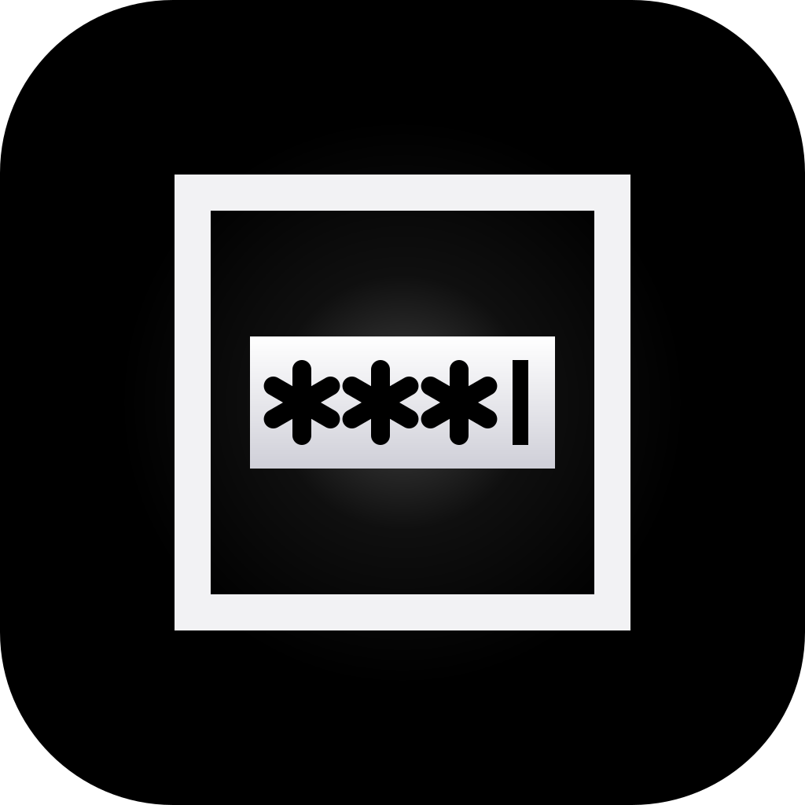
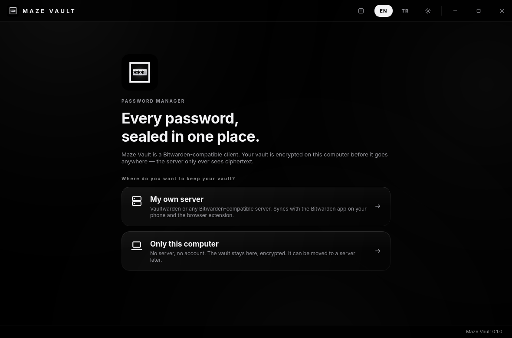
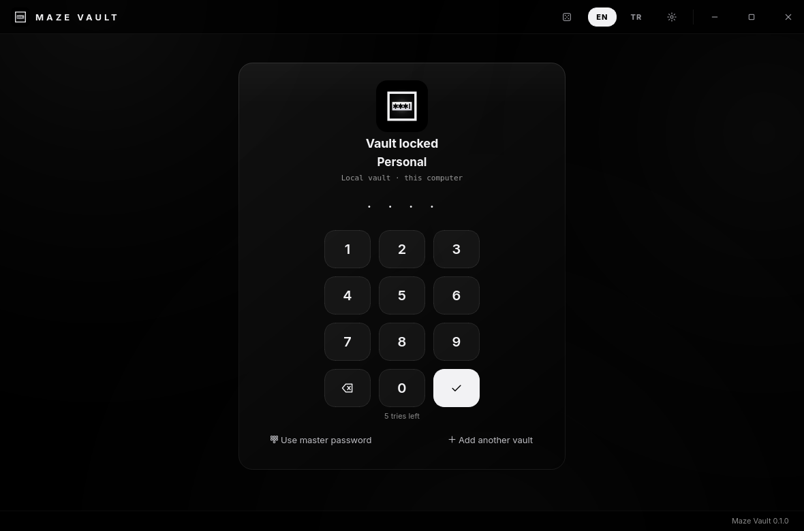
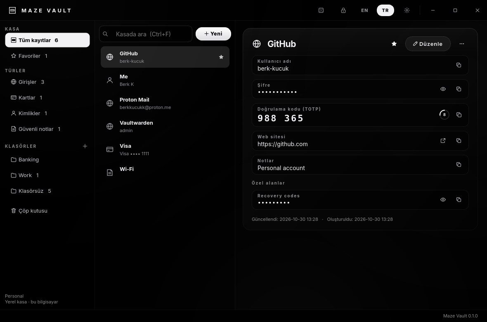

<div align="center">



# MAZE VAULT

**Every password, sealed in one place**

*Bitwarden-compatible · Your own Vaultwarden or this computer only · Encrypted before anything leaves the machine*

---

[](https://python.org)
[](https://pypi.org/project/PyQt6/)
[](https://archlinux.org)
[](https://bitwarden.com)
[](LICENSE)

</div>

---


## What is Maze Vault?

Maze Vault is a desktop password manager for Maze Linux. It is **only a
client**: it never runs a server. You choose where the vault lives.

| Mode | Where the vault is | Syncs with |
|---|---|---|
| **My own server** | Your Vaultwarden (or any Bitwarden-compatible server, Bitwarden Cloud included) | The official Bitwarden app on your phone, the browser extension, every other Bitwarden client |
| **Only this computer** | An encrypted file in `~/.local/share/maze-vault/` | Nothing; no server, no account. Can be moved to a server later in the same format |

Every item is encrypted on this computer with Bitwarden's own scheme before it
goes anywhere. The server only ever stores ciphertext and the hash of a hash
of your master password.

## Security

- **Bitwarden's cryptography, byte for byte.** PBKDF2-SHA256 or Argon2id →
  HKDF → AES-256-CBC + HMAC-SHA256, with per-item keys and RSA for shared
  vaults. Every MAC is checked in constant time *before* anything is
  decrypted.
- **Compromised-server defences.**
  - KDF parameters below Bitwarden's minimums are refused.
  - The KDF is pinned at first sign-in; a server that later offers weaker
    parameters is refused (a downgrade attack).
  - Login URIs are checked against their encrypted checksums, so a swapped
    website address is detected.
  - Every write says which account it was encrypted for (`encryptedFor`).
- **HTTPS only.** Plain HTTP is refused for every host except this machine.
- **Lock.**
  - Master password, or a 4–12 digit PIN that only lives in memory while Maze
    Vault runs. After 5 wrong PINs, the PIN is wiped.
  - Auto-lock after inactivity, when the screen locks and before sleep.
  - Locking drops the keys and every decrypted item.
- **Clipboard.** Copied secrets carry KDE's password-manager hint, so Klipper
  keeps no history of them, and are cleared after 30 s (configurable), unless
  you have copied something else meanwhile.
- **Process.** `PR_SET_DUMPABLE=0`: no core dumps, and other processes of
  your user cannot ptrace Maze Vault to read its memory.
- **Refresh token.** Stored encrypted under the vault key, never in clear.
- **No telemetry, no analytics, no third-party HTTP library.**

Honest limit: Python cannot reliably wipe memory. Locking drops every
reference to the keys, but that is not the guarantee a client written in C can
give.

## Your data does not get lost

- **Deleting means trash.** Items go to the vault's trash, from which every
  Bitwarden app can restore them. Permanent deletion only from the trash,
  after confirmation.
- **Edits never overwrite another device.** Each edit carries the revision
  it was based on. If your phone changed the item meanwhile, the server
  refuses, and Maze Vault saves your version as a separate copy. Both are kept.
- **Unknown fields survive.** An edit starts from the item exactly as the
  server sent it and replaces only what you changed. Passkeys, new item types
  and future Bitwarden fields go back untouched.
- **Damaged items are read-only.** An item that does not decrypt completely
  is shown with a warning and cannot be edited, so nothing unreadable is
  overwritten.
- **Offline and server-loss safe.** The last sync is kept encrypted on disk,
  together with the previous 10, so the vault opens without a network and can
  be recovered even if the server loses it.
- **Atomic writes.** Every file is written to a temp file, fsync'ed, renamed,
  and backed up as `.bak`.
- **Signing out archives.** Signing out moves the encrypted copy to
  `signed-out/` instead of deleting it.

## Tested against the real thing

The test suite starts a throwaway **Vaultwarden** on 127.0.0.1 (HTTPS with a
throwaway certificate) and checks every result with the **official Bitwarden
CLI**, which plays the role of the phone:

- an account created by Maze Vault signs in with the official client (PBKDF2
  and Argon2id);
- logins, cards, identities and notes written by the official client read
  correctly in Maze Vault, and the other way round;
- edits keep every other field and fill the password history;
- a stale edit is refused, never overwritten;
- trash and folders show up on the other side.

Vaultwarden alone could not prove this: it never decrypts anything, so a bug
that is consistent with itself would pass. The tests never contact a real
server.

```bash
sudo pacman -S --needed vaultwarden                        # test server
npm install --prefix .devtools @bitwarden/cli              # official client, project-local
QT_QPA_PLATFORM=offscreen /opt/maze/venv/bin/python3 -m unittest discover -s tests -v
```

Both are test-only: `vaultwarden` is a `checkdepends` of the package, never
installed for users, and the CLI lives in `.devtools/` (git-ignored).

## Screenshots

| First run | PIN lock | Türkçe |
|---|---|---|
|  |  |  |

## Building

```bash
./build-pkg.sh               # runs the tests, then makepkg → dist-pkg/
sudo pacman -U dist-pkg/maze-vault-*.pkg.tar.zst
```

## Roadmap

| Version | Planned |
|---|---|
| 0.1 (this one) | Sign-in with 2FA (authenticator, e-mail, YubiKey OTP) and new-device verification; local vaults; offline unlock; PIN; auto-lock; logins, cards, identities and notes; folders; TOTP; generator; trash; conflict copies |
| next | Offline edit queue, organisations and collections (editing), attachments, import (KeePass, browser CSV, Bitwarden JSON), encrypted export, vault health, passphrases, moving a local vault to a server |
| later | Secret Service provider, ssh-agent for vault SSH keys, quick-search popup, Send |

## License

GPL-3.0-or-later. See [LICENSE](LICENSE).
